# Regista: match intelligence you can trust, and check

**One wrong stat on air costs a broadcaster trust, and AI commentary usually cannot be checked.** Regista is a live match-intelligence studio that proves every claim. Our synthetic match engine *secretly plants* tactical changes; Microsoft Agent Framework agents on Microsoft Foundry detect and explain them from the live event stream; a Verifier re-checks every number; a human producer approves what airs as timed overlays; and a **Grader scores every explanation against the planted truth**, live and in CI.

Built for the Microsoft + Premier League *Inside the Game* Developer Hackathon with Microsoft Foundry, Microsoft Agent Framework, MCP, Azure AI Services, Microsoft Fabric, Cosmos DB, Event Hubs, Azure Functions, Azure Container Apps, Azure Static Web Apps, Azure Web PubSub and GitHub Copilot. Category: **Best Enterprise Solution**.

**Try it live:** https://lively-mushroom-048c7b70f.2.azurestaticapps.net (no login; [judge mode](#judge-mode) below). One API instance stays warm, so there's no cold start.

**Demo video (under 2 min):** https://www.youtube.com/watch?v=aktUtgPtDq0

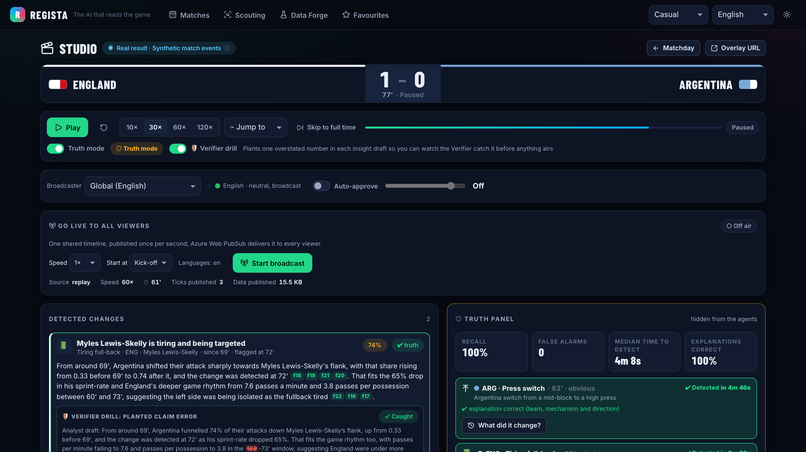

> A *regista* is the deep-lying playmaker who sees the whole pitch and dictates the tempo. Regista does that for every viewer, producer and manager: what happened, **why it mattered**, with the evidence.

## The truth loop

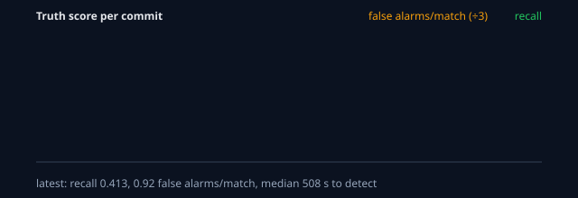

1. **Plant.** A hidden scenario script changes a team's behaviour at an exact time: a switch to a high press, a tiring full-back, a hot streak, a near-post corner routine, a chaos spell or a change of shape. The label is stored where no agent can see it.
2. **Detect.** Code detects, AI explains: per-minute features (pressing actions per opponent build-up pass, share of attacks down a flank, sprint rate, possession flips) feed a change-point test (the same idea as KQL `series_fit_2lines`). Detection has no look-ahead: it only fires once the evidence after the change exists.
3. **Explain and verify.** The Analyst writes the line from structured fields (team, mechanism, direction, before/after, change minute). The Verifier re-checks every number against the evidence and sends failures back. Each card shows its working: the feature trend, the change point and the KQL receipt. Switch on the **Verifier drill** and we plant claim errors too: the headline number in each draft is overstated on purpose, and you watch the Verifier catch it and the Analyst correct it before anything airs.
4. **Approve.** The Producer agent proposes a lower-third; a human approves (or auto-approve above a threshold the producer sets); it airs in the broadcaster profile's languages.
5. **Grade.** The truth panel lights up: detected or missed, seconds to detect, explanation right or wrong, false alarms. A counterfactual replay then re-runs the match with and without the change to measure what it really did.

**Showcase (England 1–2 Argentina, World Cup 2026 semi-final):** Argentina's planted switch to a high press at 63' is detected **4 m 46 s** later; England's tiring left-back at 69' in **3 m 30 s**; both explanations correct; no false alarms. Counterfactual: the press produced **+5.5 regains** in England's half (p10 1, p90 11, 16 paired re-runs).

**Score on fresh seeds (48 matches, 12 of them unplanted controls; 63 observable planted changes):** recall **41%**, **0.92** false alarms per match, median **8.5 min** to detect, explanation accuracy **100%** when detected. Scored in every *Test everything* run; reported by difficulty (obvious / moderate / subtle) and mechanism in the CI job summary.

## Real results, synthetic events

- **Real results.** Teams, dates, tournaments, venues, final scores, goalscorers, goal minutes, penalties, own goals and assists come from the CC0 dataset [martj42/international_results](https://github.com/martj42/international_results): 49,945 men's internationals, 1872–2026.
- **Synthetic events.** Every pass, carry, shot, freeze frame, substitution, sprint and shape change is generated by the Regista engine, constrained to reproduce the real goals exactly (real scorer, real minute, real assist).
- **Calibrated.** Team strength from Elo over every result since 1872; the engine is backtested against real fixtures (16/16 metrics in range) and its goals-vs-Elo slope matches real football (0.0021 vs 0.0021).
- **Labelled.** "Real result · Synthetic match events" on every screen. Unknown players appear as shirt numbers, never invented names; no invented cards or penalties in real rebuilds. Every number is tagged REAL or MODEL.

## What it does

| Surface | What you get |
|---|---|
| **Control room** (`/studio/:id`) | Ranked insight cards with approve / edit / kill; auto-approve above a producer-set confidence; editorial rules (no betting or loaded language); Content Safety; a full audit log; broadcaster profiles (languages, tone, brand, threshold); versioned JSON cues with translated strings; truth panel and Verifier drill; a half-time pack (talking points plus graphics that go into the approval queue); **go live to all viewers** with the real viewer count from Web PubSub (the producer's own Studio connection isn't counted) |
| **Air-ready overlays** (`/overlay/:id`) | Transparent 1920×1080 browser source for OBS / vMix driven by the cue contract (timecode, duration, priority, template, data, strings); data-only graphics fire even if AI text is slow. Add `?preview=1` to check it in a browser (checkerboard background and a "waiting for graphics" note) |
| **Matches** (`/`) | Featured real results and what-ifs, your teams first, and **replay any real match**: pick a team (and an opponent or year) to list its real results since 1872, then replay one. The engine rebuilds it in about a second with the real score, scorers and goal minutes and synthetic play between them. The dataset records scorers for every World Cup and continental final but few friendlies, and its scorer file stops at 19 July 2026. For results after that, the scorers come from published match reports in [`data/reference/goalscorers_supplement.csv`](data/reference/goalscorers_supplement.csv): each row cites its URL, a match is used only when its scorers add up to the real score, and the match's data badge links the reports. Where no source exists, the score stays real and the goals are modelled, with nobody named and the match labelled "Real score · Goals modelled". Matches that went to extra time are played to 120 minutes with their real extra-time goals; a shoot-out ends with the real winner, its kicks modelled (the dataset records only the winner) and takers shown by shirt number. all 49,945 results replay |
| **Matchday** (`/match/:id`) | A **3D live pitch** (Three.js, loaded only when shown): 22 players in their countries' kits with numbers on their backs, the ball travelling pass to pass with lofted balls arcing and a broadcast camera following play, the player on the ball named; the ball and that player come from the event stream, the other 20 are placed from each team's shape (MODEL); a ground generated for each real venue from its city, country and altitude (stands, roof, seats in the host's colours, mountains above 1,500 m), dugouts with the substitutes in bibs, staff, both managers pacing their technical areas and the fourth official; a 2D pitch for evidence. **Line-ups** beside it: each team's formation with kits, numbers and positions, substitutes in place and the bench. **Live broadcast** (one shared timeline for every viewer, fanned out by Azure Web PubSub) or a personal **replay** (own speed and seek). Five views that differ in layout and pace, not just wording: **Analyst** (dense: pitch, pulse, insight cards, event feed with pass difficulty / ball and shot speed / sprint tags at 25 km/h / distance milestones at 5, 8 and 10 km, key battle), **Casual** (big moments only, unhurried), **Player focus** (one player's touches, distance, sprints, top speed), **Team focus** (one side's story). Save a ★ favourite team or player (on Matchday, a player's Player DNA page or a team page) and every match opens on them, with your teams' matches first in the list and everything saved on one **★ Favourites** page (`/favourites`) and **Single metric** (one huge live number for a second screen). Plus control vs chaos, freeze frames, seven personas, 12 languages (Regista's own translations plus Azure AI Translator, with a football glossary, for every page), neural voice and audio description |
| **Auto-eventing** (`/match/:id/video`) | Computer vision over Regista's own broadcast feed: the 3D pitch rendered in real time from a fixed, calibrated camera with a burned-in timecode. The detector reads only pixels: it finds the hi-vis ball, maps it to pitch metres through the camera calibration, tracks it, cuts the track into passes and shots, measures distance and speed, and tells the teams apart by their kits. Every detection is graded live against the event stream (recall, precision, distance, speed and team error). Record the feed as a clip, or upload one: the same detector runs on the file and the timecode times it exactly. **Any other football clip** (a phone video of a real match, say) goes to **AI video read**: the reasoning model (gpt-5.5) reads about one frame a second in batches of eight and the page fills in possession, passes, shots, tackles, fouls, set pieces, the on-screen score and a clickable timeline as each batch returns. Those figures are the model's reading of the pictures, labelled *AI-read · not verified*: nothing is measured and there is no event record to grade them against |
| **Dugout** (`/match/:id/dugout`) | For the manager: form vs a player's own baseline, fatigue vs team-mates (altitude-aware), "replace X with Y" with predicted win-probability impact, chase/protect changes, danger men, opponent patterns, spoken assistant-coach briefing |
| **Scouting** (`/scouting`) | Player DNA (REAL record + MODEL tendencies: favourite side, foot, penalty placement, keeper dives, distance, sprints), strengths and weaknesses vs peers, "how to stop him"; a team report for every scouted national team (all of the Elo top 32), with real home/away records and "how to play against them" |
| **Tactics, Ask, Recap** | Pass networks and profiles, shape changes, xG waterfalls, control vs chaos and **game rhythm** (tempo and possession length per 15 minutes); "Ask the match" via an agent using MCP tools; multi-agent recaps with run-sheets and social packs in every persona and language; narratives carry REAL career milestones (a scorer's 10th, 50th… competitive international goal) |
| **Data Forge** (`/forge`) | Natural-language what-if matches, calibration report, truth score history; a full synthetic **season** generator with planted changes and a realism report for the Fabric Lakehouse |
| **Ops** (`/ops`) | Narrative latency SLO (p50 / p95 vs target) and cost per match (model calls, tokens, estimated cost) |

<table>
<tr><td>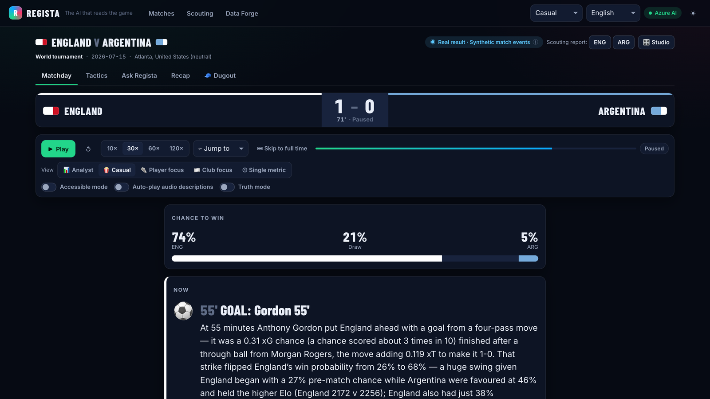</td>
<td>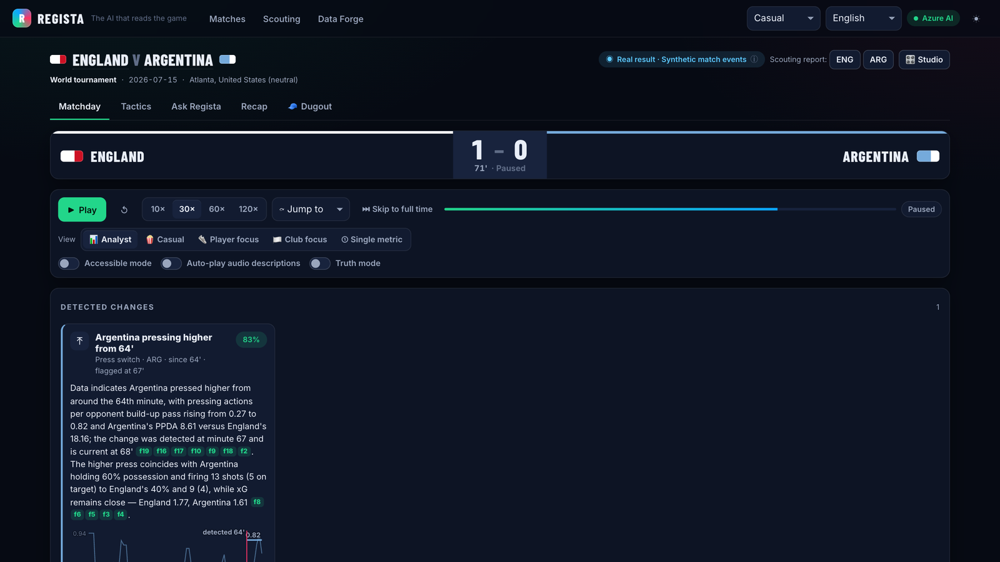</td></tr>
<tr><td align="center">Casual view: big moments, plain words</td><td align="center">Analyst view: every working shown</td></tr>
<tr><td></td>
<td>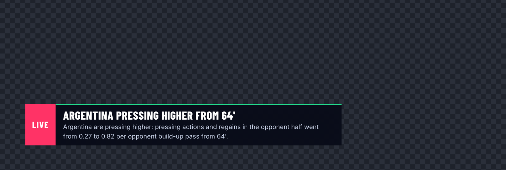</td></tr>
<tr><td align="center">Studio on Azure AI: detections graded by the truth panel</td><td align="center">Overlay: the approved lower third on air</td></tr>
<tr><td>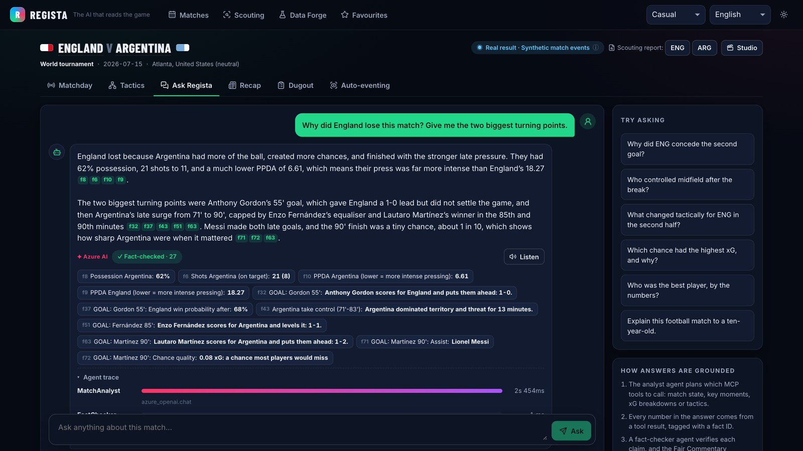</td>
<td>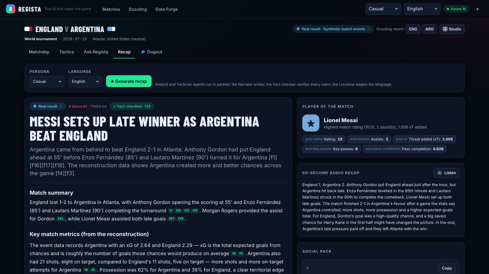</td></tr>
<tr><td align="center">Ask Regista: MCP tools, every number cited</td><td align="center">Multi-agent recap, fact-checked</td></tr>
<tr><td>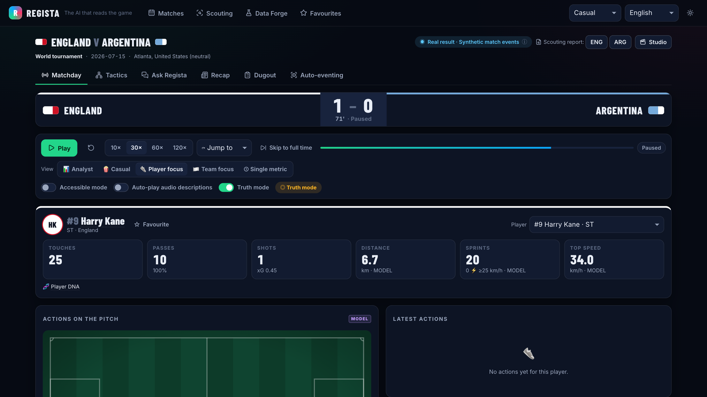</td>
<td>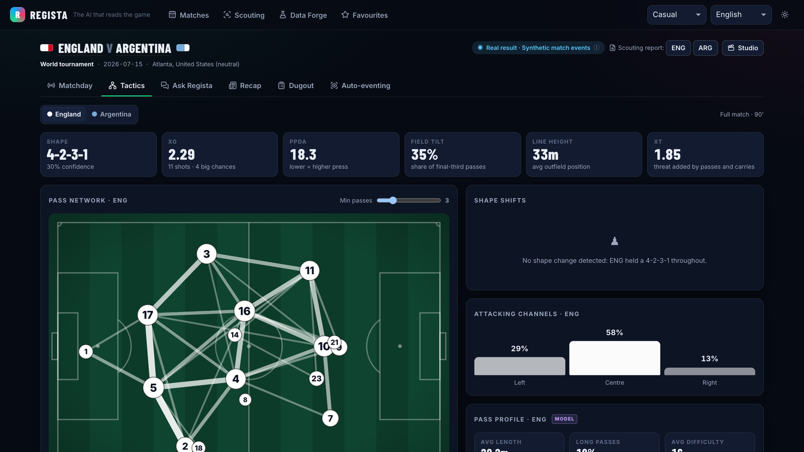</td></tr>
<tr><td align="center">Player focus: one player all match</td><td align="center">Tactics: shape, pressing and pass network</td></tr>
<tr><td>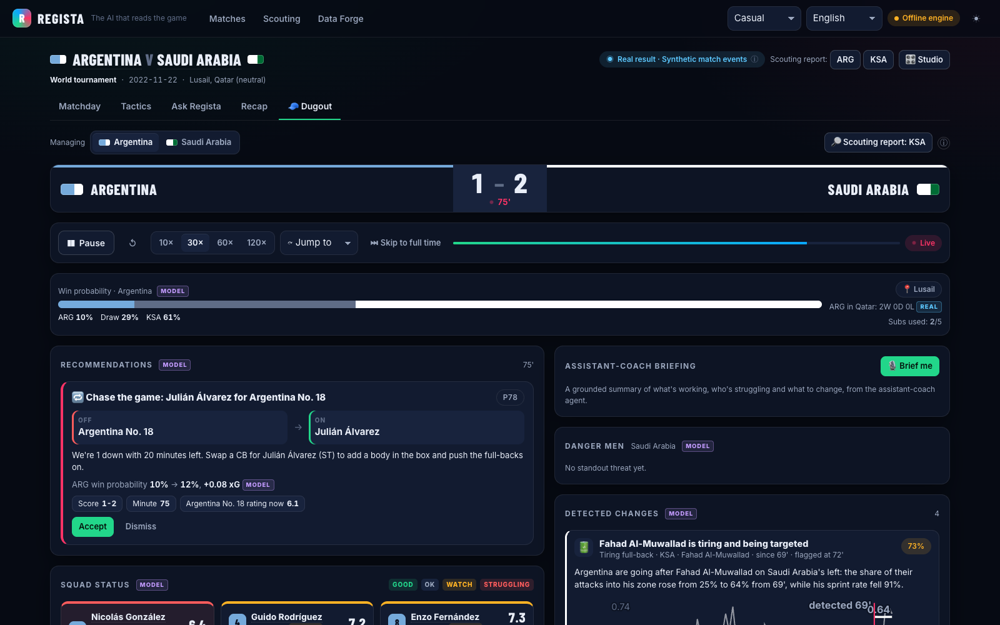</td>
<td>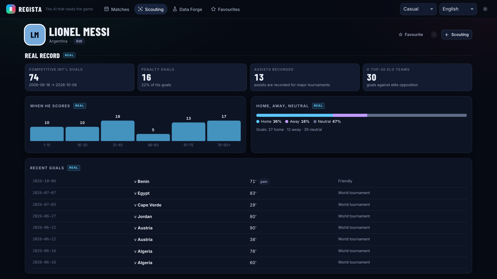</td></tr>
<tr><td align="center">Dugout: "replace X with Y" and what it is worth</td><td align="center">Scouting: Player DNA (REAL record + MODEL tendencies)</td></tr>
</table>

Screenshots are from the running app with `REGISTA_VIDEO_SAFE=1` (competition names replaced with generic labels): the gallery on Azure AI (Microsoft Foundry); the control-room image at the top on the offline engine, to show the Verifier drill catching a planted error.

## Evidence

Every *Test everything* run (Azure DevOps or GitHub Actions) runs `python -m app.evals.run --mode offline` as a gate:

| Gate | Result |
|---|---|
| Truth score: planted changes detected on fresh seeds | recall 41%, 0.92 false alarms/match, explanations 100% correct |
| Generated narratives, recaps and briefings passing the fact-checker | **100%**, 0 fair-commentary flags |
| Verifier drill: planted overstated numbers caught before air | **495 / 495** |
| Real-result fidelity (score, scorers, minutes) | **100%** |
| Calibration vs real fixtures and event benchmarks | **16/16** |
| Win-probability Brier score on real outcomes | **0.469** (coin flip: 0.667) |
| Tests | **API:** 165 unit tests, 96% statement coverage (CI floor 90%); 9 live-server integration tests over real HTTP, SSE and MCP (30 concurrent viewers, first event p95 320 ms); 6 deployed-environment tests incl. a Web PubSub round trip. **Web:** 180 Vitest tests (CI coverage floor); **20 Playwright end-to-end tests** in a real browser against the real API, incl. the hero moment, the overlay, axe accessibility scans and RTL Arabic |
| Shape changes vs ground truth | 67% precision |
| Scouting rediscovers player tendencies (674 players, every Elo top-32 team) | foot 100%, penalty side 87%, keeper dive 83% |

## Enterprise controls

- **Humans decide:** nothing airs without approval unless the producer sets an auto-approve threshold; kill switch; audit log persisted to Cosmos DB.
- **Every claim checked:** deterministic Verifier on every number and citation (proven by the Verifier drill), fair-commentary lint, Azure AI Content Safety on output, Prompt Shields on user questions, editorial rules on graphics. Known limit: the Verifier checks that a number is in the evidence, not yet that it is attached to the right claim.
- **Keyless:** one user-assigned managed identity and Entra ID everywhere; local and key auth disabled on Foundry, Cosmos DB, Event Hubs and Storage.
- **Quality gates in CI:** truth score, Verifier drill, grounding, fidelity, calibration and scouting recovery block regressions; Foundry evaluations of the deployed models on demand.
- **Built for a broadcast audience:** the API publishes each live update once; Azure Web PubSub fans it out (1,000 concurrent viewers per unit, 100 units = 100,000; Premium P2 to 1,000,000). Narration and detection cost don't grow with viewers. `scripts/loadtest-realtime.py` measures delivery latency at N concurrent viewers.
- **Observability and cost:** OpenTelemetry to Application Insights with Agent Framework spans (prompt text excluded), SLO and cost-per-match dashboard, a monthly budget alert in Bicep.
- **Brand safety:** `REGISTA_VIDEO_SAFE=1` replaces trademarked competition names with generic labels for recorded demos.

## Architecture

One codebase deploys three ways. Click a diagram for full size; the editable sources are the `.drawio` files next to them (diagrams.net or the Draw.io VS Code extension).

**1. Azure Container Apps** (default; runs the live demo): serverless, keyless, pay for use.

[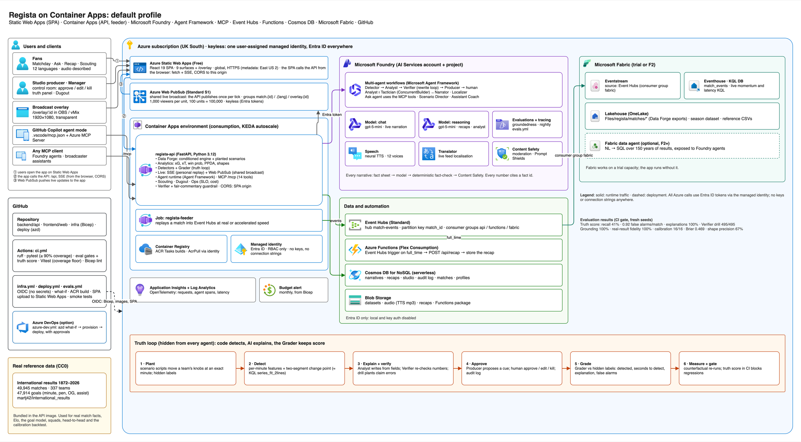](docs/architecture.png)

**2. AKS standard**: the same app on Kubernetes, Entra-only, workload identity, HTTPS from Let's Encrypt.

[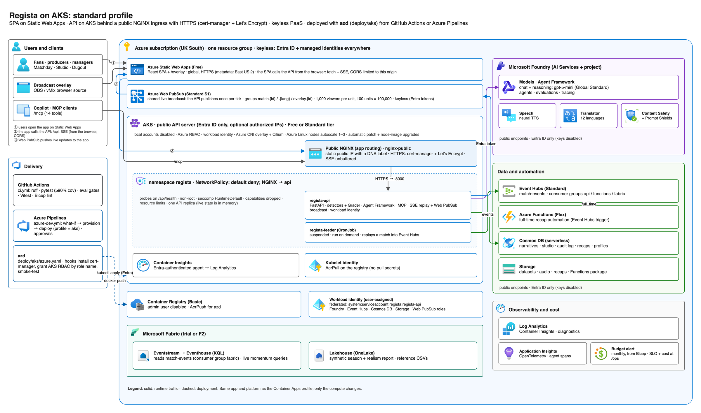](docs/architecture-aks.png)

**3. AKS enterprise**: API Management is the only public entry, a private cluster, and every data service on a private endpoint.

[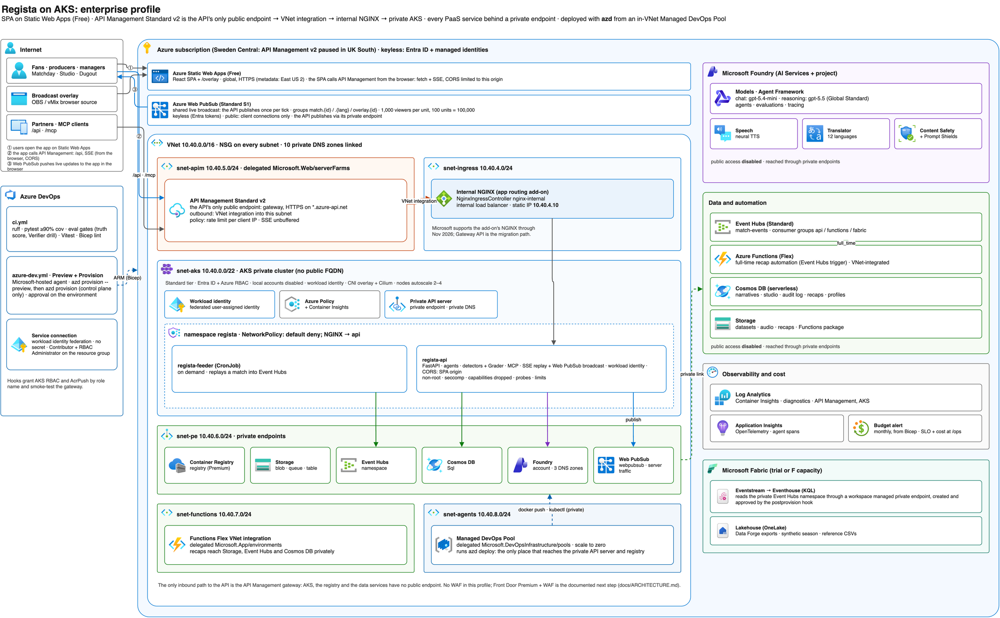](docs/architecture-aks-enterprise.png)

Sources: [architecture.drawio](docs/architecture.drawio) · [architecture-aks.drawio](docs/architecture-aks.drawio) · [architecture-aks-enterprise.drawio](docs/architecture-aks-enterprise.drawio). Details: [docs/ARCHITECTURE.md](docs/ARCHITECTURE.md) · API: [docs/API_CONTRACT.md](docs/API_CONTRACT.md) · Deploy: [docs/DEPLOYMENT.md](docs/DEPLOYMENT.md)

- **API** (`backend/api`, Python/FastAPI): match engine with planted scenarios, detectors and Grader, analytics (xG, xT, win probability, PPDA, shapes), live engine (SSE), Agent Framework agents, MCP server at `/mcp`, guardrails, ops.
- **Web** (`frontend/web`, React + TypeScript, hosted on **Azure Static Web Apps**): control room, overlay, matchday, dugout, scouting, tactics, ask, recap, forge, ops. It calls the API directly; the API's CORS allows only the Static Web App.
- **Infra** (`infra`, Bicep), three profiles on one shared platform (Foundry models, project, Speech, Translator, Content Safety; Web PubSub for the live broadcast; Event Hubs, Functions, Cosmos DB, Storage, ACR, App Insights, budget alert, optional Fabric capacity):
  - **Container Apps** (`infra/main.bicep`): API and feeder job. The cheapest; runs the live demo.
  - **AKS standard** (`infra/aks`): Entra-only AKS with workload identity, Cilium, app routing and Kubernetes manifests in `deploy/k8s`.
  - **AKS enterprise** (`infra/aks-enterprise`): API Management Standard v2 (the only public endpoint) → VNet integration → internal NGINX → private AKS; every PaaS service behind a private endpoint; deploys from a Managed DevOps Pool inside the VNet.
- **Microsoft Fabric as code** (`scripts/fabric-setup.py`, run by the azd postprovision hook): workspace, Lakehouse with the CC0 results, Eventhouse and KQL table, workspace identity, the keyless Event Hubs connection and the Eventstream into the Eventhouse. Every item is find-or-create, so re-runs change nothing (a rebuilt environment's new Event Hubs namespace re-points the Eventstream); on the enterprise profile it adds a managed private endpoint to the private Event Hubs.
- **Where the data lives**: real results ship with the API (CC0 CSVs, also in the Lakehouse under `Files/reference/`); match events are generated from them, deterministically, in memory. **Cosmos DB** holds the studio queue, audit log, recaps and broadcaster profiles; **Blob Storage** the what-if matches, audio and recaps; **Event Hubs → Eventstream → Eventhouse** the live events (KQL in [docs/kql](docs/kql)); the **Lakehouse** each Data Forge match (`Files/regista/matches/`) and the synthetic season (`Files/regista/season/`).
- **CI/CD**: **azd** for every profile (`azure.yaml`, `deploy/aks`, `deploy/aks-enterprise`); **GitHub Actions** (`.github/workflows`) and **Azure Pipelines** (`.azuredevops/pipelines`) with lint, coverage floors, evaluation gates with the truth score in the job summary, Bicep what-if, approvals and smoke tests. GitHub OIDC; bootstrap with the GitHub CLI. GitHub Copilot agent mode: `.github/copilot-instructions.md`, custom agents and `.vscode/mcp.json` (Regista MCP, Azure MCP, Fabric Eventhouse MCP).

## Judge mode

No login. Open https://lively-mushroom-048c7b70f.2.azurestaticapps.net and:
1. **Hub → England v Argentina → Studio.** Turn on **Truth mode** and the **Verifier drill**, pick **Jump to → 58:00** and play at 10×, watch Argentina's press switch (planted at 63') get detected, the Verifier catch the overstated number, approve the lower-third, see the truth panel light up, then press **What did it change?**
2. **Matchday** views: switch Analyst → Casual → Player focus to see the same match told at different pace and depth. Back in the Studio, **Start broadcast** and open the match on a second device: the viewer count goes up.
3. **Dugout** on Argentina v Saudi Arabia at 70' for live manager advice; **Scouting** for Player DNA.
4. **Forge** for calibration and the truth-score history; **Ops** for SLO and cost.
5. Point GitHub Copilot agent mode (or any MCP client) at `<api>/mcp`.

## Run locally (no Azure needed)

```bash
cd backend/api && python3 -m venv .venv && .venv/bin/pip install -r requirements-dev.txt   # Python 3.12 or newer
.venv/bin/uvicorn app.main:app --port 8000          # http://localhost:8000/docs
cd frontend/web && npm install && npm run dev           # http://localhost:5173
```

Offline mode runs the same detectors, Grader, analytics and fact-checked narratives with a deterministic engine. Set the variables in [docs/API_CONTRACT.md](docs/API_CONTRACT.md#environment-variables-read-by-the-api) (or deploy) to switch on Foundry agents, Speech, Translator, Content Safety, Cosmos DB, Event Hubs and OneLake.

```bash
cd backend/api && .venv/bin/ruff check . && .venv/bin/pytest && .venv/bin/python -m app.evals.run --mode offline
.venv/bin/python -m app.forge.season --teams 20          # 380-match synthetic season with planted changes + realism report
```

## Deploy to Azure

Three profiles share one platform (Foundry, Event Hubs, Cosmos DB, Storage, Functions, monitoring); only compute and networking change. In every profile the React front end is on **Azure Static Web Apps** and calls the API directly over HTTPS (CORS allows only the Static Web App). Rough monthly cost, estimates only, before model tokens and Fabric:

| Profile | azd project | What you get | Est. cost |
|---|---|---|---|
| Container Apps | `azure.yaml` (repo root) | Pay for use where Azure offers it (the API scales to zero); Web PubSub Standard for the live broadcast | ~$80 idle; ~$90–150 with demo traffic |
| AKS standard | `deploy/aks` | Entra-only AKS, workload identity, Cilium; the API on a stable hostname with Let's Encrypt HTTPS | ~$250–400 |
| AKS enterprise | `deploy/aks-enterprise` | API Management Standard v2 as the only public endpoint → private ingress → private AKS; private endpoints for every PaaS service | ~$1,000–1,400 |

Nothing is created until you run `azd up` or `azd provision`; `--preview` is a what-if only. Each profile sets a monthly budget alert when `BUDGET_EMAIL` is set.

### 1. Install the tools (macOS)

```bash
brew tap azure/azd && brew install azd     # Azure Developer CLI (or: curl -fsSL https://aka.ms/install-azd.sh | bash)
brew install azure-cli                     # if az isn't installed
az aks install-cli                         # kubectl + kubelogin (AKS profiles; local cluster accounts are disabled)
# Docker Desktop must be running (azd builds the API image locally) and Node.js 22.12+ (it builds the SPA)
azd version && az version && kubelogin --version && docker info > /dev/null && echo ready
```

### 2. Sign in to the right subscription

Use a personal subscription for the hackathon, not an employer or partner tenant.

```bash
az logout && az login                                   # pick your personal account
az account show --query "{name:name, user:user.name}"   # check before going any further
azd auth login                                          # azd signs in separately; use the same account
```

### 2b. Prepare a new subscription (once; free)

New subscriptions start with no resource providers registered, and often with **zero quota** for the newest models and some VM families. Check before the first deploy:

```bash
for ns in Microsoft.CognitiveServices Microsoft.App Microsoft.ContainerRegistry Microsoft.DocumentDB Microsoft.EventHub \
          Microsoft.Storage Microsoft.Web Microsoft.OperationalInsights Microsoft.Insights Microsoft.ManagedIdentity \
          Microsoft.Compute Microsoft.ContainerService Microsoft.Network Microsoft.ApiManagement; do
  az provider register --namespace "$ns" --wait
done
az cognitiveservices usage list -l uksouth --query "[?contains(name.value,'GlobalStandard.gpt-5')]" -o table   # model quota
az vm list-usage -l uksouth -o table | grep -i -E "Total Regional|DDSv6|DDSv5"                              # vCPU quota (AKS)
```

If the default models (`gpt-5.4-mini`, `gpt-5.5`) show a limit of 0, use a model you do have quota for and request an increase in the Foundry portal (Quotas):

```bash
azd env set CHAT_MODEL_NAME gpt-5-mini && azd env set CHAT_MODEL_VERSION 2025-08-07
azd env set REASONING_MODEL_NAME gpt-5-mini && azd env set REASONING_MODEL_VERSION 2025-08-07
```

Other settings you can override the same way: `STATIC_WEB_APP_LOCATION` (default `eastus2`; Static Web Apps isn't in UK South and West Europe refuses some new subscriptions), and for AKS `AKS_NODE_VM_SIZE` (default `Standard_D4ds_v6`; v5 families often have 0 quota on new subscriptions), `AKS_NODE_MIN_COUNT` and `AKS_NODE_MAX_COUNT` (defaults fit the usual 10 vCPU limit).

If azd says it can't access a subscription you just created, it is using a stale cache: run `azd auth login` again.

### 3a. Container Apps (default)

```bash
azd env new regista --location uksouth          # 12 characters max: the name goes into every resource name
azd env set AZURE_RESOURCE_GROUP rg-regista
azd env set BUDGET_EMAIL you@example.com               # optional budget alert
azd provision --preview                                # what-if (azd's summary lists only the types it has names for)
scripts/preview-all.sh                                 # every resource, incl. Web PubSub + hub, plus a Fabric dry run; read-only
                                                       #   (--profile aks | aks-enterprise for the other azd projects)
azd up                                                 # provision + build + deploy + smoke test
# Pay-for-use: the API scales to zero, so the first request after idle takes ~20-40 s. While judging or recording:
#   azd env set API_MIN_REPLICAS 1 && azd provision
```

Without azd: `scripts/deploy.sh --rg rg-regista --location uksouth --env regista --budget-email you@example.com`.

### 3d. Microsoft Fabric (optional, any profile)

Fabric items aren't Azure resources, so the postprovision hook creates them through the Fabric API. Start the free Fabric trial once at https://app.fabric.microsoft.com (same account), then:

```bash
azd env set FABRIC_WORKSPACE_NAME Regista
azd provision          # workspace, Lakehouse + real CC0 data, Eventhouse/KQL table, keyless workspace identity
```

The same hook creates the Event Hubs connection (workspace identity, no keys) and the Eventstream (Event Hubs → Eventhouse), so there are no portal steps; every item is find-or-create, so re-runs change nothing. Details: [docs/DEPLOYMENT.md §5](docs/DEPLOYMENT.md#5-microsoft-fabric-lakehouse--real-time-intelligence).

### 3b. AKS standard

```bash
cd deploy/aks
azd env new regaks
azd env set AZURE_RESOURCE_GROUP rg-regista-aks
azd env set LETSENCRYPT_EMAIL you@example.com                               # for the API's HTTPS certificate
azd env set AKS_AUTHORIZED_IP_RANGES "$(curl -s https://api.ipify.org)/32"   # optional: API server only from your IP
azd provision --preview
(cd ../.. && scripts/preview-all.sh --profile aks)                          # full what-if + Fabric dry run
azd up
```

Set `LETSENCRYPT_EMAIL` first (`azd env set LETSENCRYPT_EMAIL you@example.com`): the API gets a stable hostname and a Let's Encrypt certificate, because the SPA on Static Web Apps is HTTPS. The hooks grant you *Azure Kubernetes Service RBAC Cluster Admin* and AcrPush, install cert-manager, and smoke-test the API, its CORS and the site.

### 3c. AKS enterprise (private, behind API Management)

The cluster and registry are private: you **provision from your machine**, then **deploy the app from the Azure DevOps
pipeline**, whose Deploy stage runs on a Managed DevOps Pool agent inside the VNet. About $1,000–1,400 a month while it
runs (API Management Standard v2 is most of it), so tear it down when you're done.

**1. Check capacity first (once per subscription and region).** Three separate limits apply:

| What | Needed | Where to check or request |
|---|---|---|
| Compute vCPUs for the AKS nodes (`Standard Ddsv6 Family`) | 8 (2 nodes × 4), more for upgrade surge: request 20 | Portal → Quotas → Compute |
| **Managed DevOps Pools** cores for the agent (`Standard DADSv5 Family`) | 2. New subscriptions can start at 0 for every family | Portal → Quotas → **Managed DevOps Pools** → Request adjustment (usually approved in moments) |
| API Management **Standard v2** in the region | 1 instance | No quota page: if Azure has paused new Standard v2 instances in the region (`ApiServiceCreationDisabledForSubscription`), retry later or use another region for the whole profile (API Management and the VNet must share a region) |

Model quota (`gpt-5.4-mini` and `gpt-5.5`, or `gpt-5-mini` as the fallback) as in step 2b. The agent size is `Standard_D2ads_v5` on purpose: Azure Pipelines agent
images don't support v6/v7 sizes.

**Choosing the region.** Every service in this profile must be offered in the region, and API Management must share it
with the VNet. As of October 2026 (re-check: [API Management v2 regions](https://learn.microsoft.com/azure/api-management/api-management-region-availability)):

| Region | API Management Standard v2 | Dev Center (agent pool) | `gpt-5-mini` | Notes |
|---|---|---|---|---|
| UK South | paused for new instances | yes | yes | new subscriptions also start with 0 agent-pool cores |
| UK West | yes | **no** | **no** | not usable for this profile |
| **Sweden Central** | yes | yes | yes | works end to end; default agent-pool quota (5 cores); data stays in the EU |

**2. Create the environment and provision** (30–45 minutes):

```bash
cd deploy/aks-enterprise
azd env new regse --location swedencentral                        # see "Choosing the region"
azd env set AZURE_RESOURCE_GROUP rg-regista-ent-se
azd env set CHAT_MODEL_NAME gpt-5-mini && azd env set CHAT_MODEL_VERSION 2025-08-07          # if gpt-5.4-mini quota is 0
azd env set REASONING_MODEL_NAME gpt-5-mini && azd env set REASONING_MODEL_VERSION 2025-08-07
azd env set APIM_PUBLISHER_EMAIL you@example.com
azd env set AZURE_DEVOPS_ORG_URL https://dev.azure.com/<org>                                  # the in-VNet agent pool registers here
azd env set DEVOPS_INFRASTRUCTURE_PRINCIPAL_ID "$(az ad sp list --display-name DevOpsInfrastructure --query '[0].id' -o tsv)"
azd env set FABRIC_WORKSPACE_NAME Regista                                                     # optional (step 3d)
azd env set BUDGET_EMAIL you@example.com                                                      # optional budget alert
azd provision --preview
(cd ../.. && scripts/preview-all.sh --profile aks-enterprise)       # full what-if + Fabric dry run (managed private endpoint)
azd provision                                                       # API_URL = API Management gateway, WEB_URL = Static Web App
```

The postprovision hook grants roles and runs the Fabric setup; on this profile it also creates and approves a Fabric
managed private endpoint to the private Event Hubs. Fabric tests a new connection from its shared service, which the
private namespace may refuse: the hook then prints a one-line portal step instead of failing. It skips the `kubectl`
steps because your machine can't reach the private cluster.

**3. Connect Azure DevOps to the environment** (once): service connection, variable group `regista-aks-enterprise` and
environment `regista-aks-enterprise`.

```bash
cd ../..
az extension add --name azure-devops
export AZURE_DEVOPS_EXT_PAT=<PAT: service connections, variable groups, environments, build>
scripts/setup-azure-devops.sh --org https://dev.azure.com/<org> --project <project> \
  --profile aks-enterprise --rg rg-regista-ent-se --location swedencentral --env regse \
  --apim-email you@example.com --repo-type github --repo <owner>/<repo> --github-connection <github-service-connection>
```

Then add an **approval check** on the `regista-aks-enterprise` environment (Pipelines → Environments).

**4. Deploy from the pipeline, in two runs.** Commit and push first: the pipeline builds from the repository.

1. Run **Regista › Infrastructure** with **profile = `aks-enterprise`**. It creates everything, including the in-VNet
   agent pool `regista-mdp`. (Skip this run if you already provisioned with `azd provision` from your machine.)
2. Run **Regista › Full environment** with **profile = `aks-enterprise`** (managedPool keeps its default, `regista-mdp`).
   Its Deploy stage runs on that agent: it builds the API image into the private registry and applies
   `deploy/k8s/aks-enterprise`.

Why two runs: Azure DevOps checks every pool a pipeline uses *before* any stage starts, so Full environment can't be the
run that creates its own agent pool (error: "Could not find a pool with name regista-mdp").

**5. Check it:** `azd -C deploy/aks-enterprise env get-value API_URL` (the API Management gateway, the only public entry
point) and `WEB_URL` (the site). Open the site and run the judge-mode steps.

**Tear down:** `azd down --purge` from `deploy/aks-enterprise` (it also purges the soft-deleted API Management and
Foundry accounts).

Development only: `azd env set AKS_PRIVATE_CLUSTER false` and `azd env set AKS_AUTHORIZED_IP_RANGES <your-ip>/32` make
the API server public but IP-restricted. There is no WAF in this profile; for production, add Front Door Premium in front
of API Management ([design and steps](docs/ARCHITECTURE.md#future-azure-front-door-in-front-of-api-management)).

### 3e. Live broadcast at scale (Web PubSub)

Every profile deploys Azure Web PubSub (Standard, 1 unit = 1,000 concurrent viewers). Start a shared live broadcast from the Studio (*Go live to all viewers*), then measure it:

```bash
python scripts/loadtest-realtime.py --api "$(azd env get-value API_URL)" --match-id 2026-07-15-england-argentina --clients 500 --seconds 60
azd env set WEBPUBSUB_UNITS 100 && azd provision      # 100,000 concurrent viewers (billed per unit-day: scale up for match days)
```

### 4. Azure DevOps pipelines (optional)

**One command per environment** (after the one-time organisation setup below): `scripts/deploy-env.sh --profile
containerapps|aks|aks-enterprise --email you@example.com [--fabric]` prepares the azd environment, runs
`setup-azure-devops.sh`, grants the pipeline identity its Azure DevOps agent-pool rights (enterprise), runs the pipelines
in the right order (enterprise: Infrastructure, then Full environment) waiting for each, and smoke-tests the result.
`scripts/teardown-env.sh --profile …` deletes the environment and purges the recycle bin so the names can be reused.

**Your Azure DevOps organisation.** `dev.azure.com` sends you to the Azure marketing/portal page when the browser's
signed-in account has no organisation. Open https://aex.dev.azure.com/me signed in as the account of the subscription's
tenant (the same one as `az account show --query user.name`): it lists your organisations, or *Create new organization*.
Organisations created there are backed by that Microsoft Entra tenant, which the keyless service connection needs.
Then create a project (private) in it.

**Parallel jobs.** A new organisation has no Microsoft-hosted parallel job, and pipelines fail with *No hosted
parallelism has been purchased or granted*. Either request the free grant (https://aka.ms/azpipelines-parallelism-request,
2–3 business days) or buy one Microsoft-hosted parallel job: *Organization settings → Billing*, link the subscription,
set *MS Hosted CI/CD* to 1 (about $40/month; set it back to 0 afterwards). The enterprise Deploy stage runs on the
Managed DevOps Pool, which uses the organisation's free self-hosted parallel job; its VMs bill to your subscription.

`.azuredevops/pipelines/ci.yml` (*Test everything*) mirrors GitHub CI; it deploys nothing. Every pipeline is manual: nothing runs on a push. Each part has its own manual, independent pipeline: `infra.yml` (what-if → provision), `api.yml`, `frontend.yml`, `functions.yml` and `jobs.yml` (the feeder job). `azure-dev.yml` (*Full environment*) deploys everything in one run, for the first setup. Every deployment waits for approval on the `regista-<profile>` environment ([details](docs/DEPLOYMENT.md#azure-devops-pipelines)). One-time setup (keyless service connection, variable group, all pipelines):

```bash
az extension add --name azure-devops
export AZURE_DEVOPS_EXT_PAT=<PAT: service connections, variable groups, environments, build>
scripts/setup-azure-devops.sh --org https://dev.azure.com/<org> --project <project> \
  --profile aks-enterprise --rg rg-regista-ent-se --location swedencentral --env regse \
  --apim-email you@example.com --budget-email you@example.com \
  --repo-type github --repo <owner>/<repo> --github-connection <github-service-connection>
```

Then add an approval check on the `regista-<profile>` environment and run **Regista › Full environment** (for enterprise, run **Infrastructure** first: it creates the `regista-mdp` agent pool the deploy uses).

### 5. GitHub Actions (Container Apps)

The same pipelines and names as Azure DevOps: *Infrastructure*, *API*, *Frontend*, *Functions*, *Container jobs* and
*Full environment*, each manual and independent, each running CI's checks first and waiting for approval on the
`production` environment. *Test everything* is manual too ([details](docs/DEPLOYMENT.md#3-build-and-deploy-the-apps)).

```bash
gh auth login
scripts/bootstrap-github-oidc.sh --rg rg-regista --location uksouth --env regista   # keyless login, secrets, variables, approvals
gh workflow run infra.yml                                                          # infrastructure
gh workflow run deploy.yml                                                         # everything once
```

### Tear down

```bash
scripts/teardown-env.sh --profile containerapps   # or aks / aks-enterprise: azd down --purge + recycle-bin purge
```

Or `azd down --purge` from the profile's folder. Soft-deleted Foundry and API Management accounts can outlive it and block
reusing the same names for 48 hours; the script purges them.

More detail (Fabric setup, troubleshooting): [docs/DEPLOYMENT.md](docs/DEPLOYMENT.md).

## Next steps

- **Sign-in and favourites on every device.** Today favourites, persona and language are saved in the browser, so anyone can try Regista without an account. The next step is sign-in with Microsoft Entra External ID, with each fan's favourites and preferences stored in Cosmos DB so they follow them to any device.
- **A WAF in front of the enterprise profile.** Azure Front Door Premium in front of API Management, with API Management made private; the design is in [docs/ARCHITECTURE.md](docs/ARCHITECTURE.md#future-azure-front-door-in-front-of-api-management).
- **Scale the API out.** Live sessions, the studio queue and caches are in memory, so the API runs as one replica; moving that state to Cosmos DB or Redis allows more.
- **A stricter Verifier.** It checks that every number is in the evidence; next, that each number is attached to the right claim.

## How it was built

I designed Regista, chose the architecture and the trade-offs, and reviewed and tested every change. AI coding assistants wrote much of the code with me, and the repo carries the GitHub Copilot setup used day to day: [instructions](.github/copilot-instructions.md), [custom agents](.github/agents/), [prompt files](.github/prompts/) and MCP servers in [.vscode/mcp.json](.vscode/mcp.json). The code is held to the same rule as the product's AI: every number comes from code, and the tests and evaluation gates above run on every change.

## Licence and data

Code: MIT ([LICENSE](LICENSE)). Reference data: CC0-1.0 ([martj42/international_results](https://github.com/martj42/international_results)).
Match results are real; every event below the result is a synthetic reconstruction. Regista uses no logos, crests or footage.
