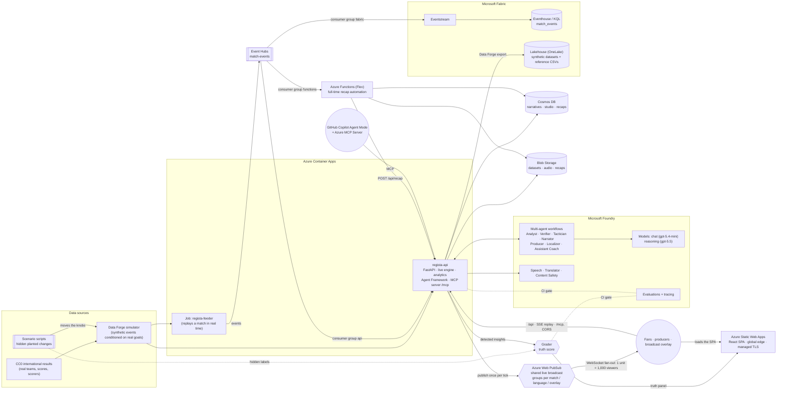

# Regista architecture

Regista rebuilds **real international matches** from the public CC0 results dataset ([martj42/international_results](https://github.com/martj42/international_results): 49,945 results 1872–2026, goalscorers with minutes, shootouts). It then generates **synthetic, football-realistic ball-by-ball events** conditioned on those real goals, and turns them into explainable match intelligence: live narratives, studio graphics and automated recaps. Teams, scores, scorers and goal minutes are real. Everything below the result (passes, carries, shots, positions, xG) is a reconstruction and is labelled as such.

One loop sits beside the product that the agents never see: the generator **secretly plants** tactical changes (a press pushed higher, a tiring full-back, a switch of shape) and a **Grader** scores whether the agents detected and explained each one, how fast and how accurately, live in the control room and on every commit in CI.

Everything runs on Azure, is deployed from GitHub with Bicep, and is **keyless**: every service-to-service call uses Microsoft Entra ID through one user-assigned managed identity.

## System view

### Live path, one event end to end

1. **Source.** `regista-feeder` (a Container Apps job) or the API's in-process replay emits contract `Event`s at match speed. In Event Hubs mode they are published to `match-events`, with `match_id` and `type` as application properties.
2. **Interpret.** The API consumes the `api` consumer group. It updates incremental state (score, xT momentum, Poisson win probability, xG, PPDA) and runs the moment detectors (goal, big chance, momentum swing, tactical shift, win-probability swing).
3. **Explain.** For each moment, the Agent Framework workflow runs **Narrator → Fact-checker → Producer** on the fast `chat` deployment. The narrative is written in the viewer's persona and language. Every number must cite a `fact_id`, or the fact-checker rejects the sentence.
4. **Render.** The result is published **once** to Azure Web PubSub (the shared live broadcast; every viewer of the match sees the same moment) and also served over SSE for personal replays (own speed, seek, persona). The studio console receives proposed graphics, a producer approves them, and they go on air in the overlay (`/overlay/:matchId`, an OBS/vMix browser source).
5. **Persist and analyse.** Narratives and studio items go to Cosmos DB. Fabric Eventstream lands the raw events in the Eventhouse for KQL analytics. On `full_time`, the Function generates the broadcaster recap and stores it in Cosmos DB and Blob Storage.

### Realtime at broadcast scale (Azure Web PubSub)

A broadcaster's audience is one shared live timeline, so the work must not grow with viewers:

- **One publisher.** The live timeline comes from the feeder through Event Hubs (`LIVE_SOURCE=eventhub`), or from a shared server-side replay started in the Studio. The API publishes one batched `tick` per second to the group `match.{id}`, each narrative once per language to `match.{id}.{lang}`, and on-air cues to `overlay.{id}` (`docs/API_CONTRACT.md`, "Realtime broadcast").
- **Web PubSub does the fan-out.** 1,000 concurrent connections per unit, up to 100 units (100,000 viewers) per resource on Standard_S1 / Premium_P1; Premium_P2 goes to 1,000,000; the subscription default is 150 units per region (soft limit). Scaling is a unit change: `azd env set WEBPUBSUB_UNITS 100 && azd provision`.
- **Flat costs where they matter.** AI narration, fact-checking and detection run once per event, not per viewer. Web PubSub bills per unit-day plus outbound messages, where every delivery to every viewer counts in 2 KB chunks (1M messages per unit per day included). That is why the tick is batched once a second and stripped of freeze frames.
- **Keyless.** Local auth is disabled; the API issues short-lived client tokens with Microsoft Entra ID (`Web PubSub Service Owner`) scoped to `joinLeaveGroup` roles for the match's groups. In the enterprise profile the public endpoint accepts only client connections and the API publishes through a private endpoint.
- **Measured, not asserted.** `scripts/loadtest-realtime.py` opens N concurrent viewers and reports delivery latency p50/p95/p99 from each tick's `sent_at`.

Order of magnitude for a real match (estimates; confirm in the pricing calculator): 100,000 viewers × one ~1–2 KB tick per second × 2 hours ≈ 720M deliveries. With 100 units (100M messages a day included) the day costs roughly the units plus the overage, in the high hundreds of dollars: proportionate for a rights holder, and paid only on match days. For the hackathon one Standard unit (1,000 concurrent viewers) costs about $49 a month.

### Truth loop

Code detects, AI explains, and a grader keeps everyone honest.

1. **Plant.** A scenario script (`press_switch`, `shape_change`, `tiring_fullback`, `hot_streak`, `set_piece_routine`, `chaos_spell`) moves a team's knobs at an exact minute and writes a label: team, mechanism, direction, minute and difficulty (obvious, moderate or subtle). Labels live in `meta.truth` and are stripped from every normal endpoint, fact sheet and MCP tool.
2. **Detect.** `analytics/insights.py` computes per-minute features from the event stream alone (pressing actions per opponent build-up pass, share of attacks down a flank, sprint rate, shot quality, near-post corners, possession flips, formation template). It runs a two-segment change-point fit (the same idea as KQL `series_fit_2lines`) and a two-proportion test against the pre-change baseline. A detection fires only once the post-change evidence exists (live-honest).
3. **Explain and verify.** The Analyst writes the line from the structured insight (team, mechanism, direction, before, after, change minute). The Verifier re-checks every number against the evidence and sends failures back for a rewrite. The **Verifier drill** plants an overstated number in a draft to show the catch on screen; it is also an eval gate.
4. **Approve.** The Producer proposes cues; the human producer approves, edits or kills them (or auto-approve above their threshold); editorial rules and Content Safety apply; every decision lands in the audit log.
5. **Grade.** `analytics/grader.py` matches insights to plants (right team, mechanism and direction in a window from 4 minutes before to 12 after). It reports recall on observable plants, false alarms (including unplanted control matches), seconds to detect and explanation accuracy. Natural changes the engine produced on its own (for example a press driven by game state) are labelled too, so they are not counted as false alarms.
6. **Measure.** `analytics/counterfactual.py` re-runs the same seeded match with and without the plant (16 paired runs) and reports the effect with a p10–p90 range.

In CI, `python -m app.evals.run --record` scores 48 fresh-seed matches (36 with plants, 12 controls), writes `data/reference/truth-latest.json` and the history, redraws `docs/truth-score.svg`, and posts the score to the job summary. The gate fails if recall drops below 0.35 or false alarms rise above 1.5 per match.

### Governance (control room)

- **Broadcaster profiles** (`ai/producer.py`): languages, tone, graphics brand and auto-approve threshold for each rights holder.
- **Cue contract v1.0**: timecode, duration, priority, template, data and translated strings. The overlay renders data-only graphics immediately and adds the AI line when it arrives.
- **Editorial rules**: no betting or odds language and no loaded descriptors, plus Content Safety. A blocked cue cannot go on air (HTTP 409).
- **Audit log**: every approve, edit, kill and auto-approval, with who and when, persisted to Cosmos DB.

### Multi-agent design

| Agent | Model | Tools | Job |
|---|---|---|---|
| Match Analyst | reasoning | Regista MCP tools (match state, moments, xG breakdown, player stats, period comparison) | Answers "Ask Regista" questions with evidence |
| Tactician | reasoning | Tactical summary, pass network, formation-shift detector | Explains shape, pressing and overloads |
| Narrator | chat | Fact sheet (no free computation) | Persona and language-specific commentary and recaps |
| Fact-checker / Verifier | deterministic, plus a chat rewrite | Fact sheet or insight evidence | Rejects any number or citation not in the evidence, sends failures back to the Analyst, lints biased descriptors |
| Insight Analyst | chat | Structured insight from the detectors | Explains a detected tactical change in one or two sentences with its numbers |
| Grader | deterministic (by design) | Hidden plant labels plus insights | Scores detection, time to detect and explanation; compares structured fields, not opinions |
| Producer | chat | Studio queue | Ranks moments, drafts lower thirds, stat cards and talking points |
| Localizer | Translator + chat | Azure AI Translator | High-volume live translation; LLM polish for recaps |
| Scenario Director | reasoning | Simulator config schema | Natural-language scenario → Data Forge config |
| Assistant Coach | chat | Dugout recommendations (form, fatigue, substitutions with win-probability impact) | Spoken touchline briefing for the manager |
| Scout (tools) | reasoning | `get_player_dna`, `get_team_report`, `get_dugout_advice` over MCP | Opposition scouting and "how to stop him" answers |

The agents reach match data through the **same MCP server** (`/mcp`) that broadcasters and GitHub Copilot use. One tool surface serves every client.

## Code structure

Both sides are layered so each module has one reason to change, and each layer depends on an abstraction of the one below it (SOLID: single responsibility, dependency inversion).

**API (`backend/api/app`)**

| Layer | Where | Responsibility |
|---|---|---|
| Composition root | `main.py` | `create_app()`: lifespan (load data, warm caches, Event Hubs consumer), middleware, routers, MCP mount |
| HTTP | `api/routes/*.py` | One `APIRouter` per domain (matches, studio, truth, forge, scouting, dugout, reference, narration, language, realtime, system). Validate input, call a service, map domain errors to HTTP status |
| Contracts | `api/schemas.py` | Request models (Pydantic) |
| Dependencies | `api/deps.py` | What routes receive through `Depends`: the match store, reference data, the speech and translation engines, `require_match`. Tests swap them with `app.dependency_overrides` |
| Use cases | `services/*.py` | Moment detail, truth grading, counterfactuals, Data Forge generation, speech caching (`Memo`); no HTTP |
| Domain | `analytics/`, `ai/`, `forge/`, `live/`, `integrations/` | Match analytics, agents, the simulator, live replay and broadcast, Azure adapters |
| Agent tools | `ai/tools/` | The 14 match-intelligence tools, one module per area (`match`, `reference`, `scouting`, `forge`). Each registers itself with `@tool` in `ToolRegistry` (`registry.py`), which feeds the MCP server, the Agent Framework agents and the OpenAI tool loop. A new tool is a decorated function, with no list to edit. Tools stay plain functions because all three build the model's schema from the function's name, annotations and docstring |
| Outbound HTTP | `integrations/http.py` | `HttpClient`: the one pooled REST client every class shares (bearer token per call, timeout from settings, error on non-2xx). `ai/services.py`'s `AzureAIServices` (Speech, Translator, Content Safety, Prompt Shields) receives it, a token provider and the settings through its constructor. Azure SDK clients keep their own transports |
| Settings | `config.py` | Every endpoint, REST path, API version, limit and timeout, from app settings (`infra/modules/api-settings.bicep` for the service-contract values) or `backend/api/.env` locally. No keys anywhere: Microsoft Entra tokens only |

**Web (`frontend/web/src/api`)**

| Layer | Where | Responsibility |
|---|---|---|
| Transport contract | `http/HttpClient.ts` | The interface services depend on: `get`, `post`, `postBlob`, `url` |
| Transport | `http/AxiosHttpClient.ts` | axios, a 120 s timeout, `ApiError` from the API's `detail`, and the global loading indicator on every call |
| Domain services | `services/*Service.ts` | One class per area of the API (`MatchService`, `StudioService`, `TruthService`, `ForgeService`, `ScoutingService`, `DugoutService`, `ReferenceService`, `NarrationService`, `LanguageService`, `BroadcastService`, `SystemService`), each constructed with an `HttpClient` |
| Composition root | `index.ts` | Creates the one `AxiosHttpClient` and the service instances components import |

**Loading feedback.** Every call through `AxiosHttpClient`, and every live stream still connecting, counts as activity (`lib/activity.ts`). The app shows a progress bar and a "Loading…" status after 300 ms, then explains a cold start after 5 s, because the API scales to zero. Placeholders 60 px or taller carry a spinner, and busy buttons show one (`aria-busy`). A poll refreshing data already on screen runs inside `quietly(...)` and stays silent.

## Deployment profiles

One platform, three ways to run the compute. In every profile the React front end is on **Azure Static Web Apps** and calls the API directly (fetch and server-sent events) at a URL baked in at build time, with the API's CORS limited to the Static Web App's origin. A linked backend was ruled out: it needs the Standard plan, can't link AKS, and would put a proxy in front of the live streams. All three are azd projects, built from the same Bicep modules, and deployed by azd, GitHub Actions or Azure Pipelines (details and costs in [DEPLOYMENT.md](DEPLOYMENT.md#deployment-profiles)).

| | Container Apps | AKS standard | AKS enterprise |
|---|---|---|---|
| Diagram | [architecture.drawio](architecture.drawio) | [architecture-aks.drawio](architecture-aks.drawio) | [architecture-aks-enterprise.drawio](architecture-aks-enterprise.drawio) |
| Entry point | `infra/main.bicep` | `infra/aks/main.bicep` | `infra/aks-enterprise/main.bicep` |
| Front end | Azure Static Web Apps (Free) | Azure Static Web Apps (Free) | Azure Static Web Apps (Free; Standard optional for the SLA) |
| API edge | Container Apps ingress (HTTPS) | App routing NGINX on a static public IP with a DNS label, HTTPS from cert-manager + Let's Encrypt | API Management Standard v2 (public gateway, rate limits) → VNet integration → internal NGINX (10.40.4.10) |
| Cluster access | n/a | Public API server, Entra-only, optional authorized IPs | Private API server; deploys from a Managed DevOps Pool in `snet-agents` |
| PaaS network | Public endpoints, Entra-only | Public endpoints, Entra-only | Public access disabled; private endpoints + 9 private DNS zones |
| Identity | User-assigned identity | Workload identity federated to the same identity; kubelet AcrPull | Same, plus NSGs, Cilium network policies, Azure Policy |
| Use | Live judge demo (cheapest) | Kubernetes without the enterprise network | A production reference for a rights holder |

API Management is Standard v2 because it is the cheaper of the two tiers with outbound VNet integration, which lets a public gateway reach a private ingress. It is the only public endpoint in the enterprise profile; there is no WAF, so production should add Front Door Premium or Application Gateway WAF in front of it (see *Future: Azure Front Door* below). The API runs as one replica in every profile: live sessions, the studio queue and caches are in memory, so scaling out first needs sticky sessions or that state in Cosmos DB / Redis.

### Future: Azure Front Door in front of API Management

The enterprise profile ships without a WAF to keep it simple and affordable for the hackathon. The production step is to put **Azure Front Door Premium** in front of API Management and make API Management private. This design was built and validated (Bicep build and lint) before it was deliberately removed. To bring it back:

| Piece | Design |
|---|---|
| Front Door | `Microsoft.Cdn/profiles` with `Premium_AzureFrontDoor` (Private Link origins need Premium); one endpoint; route `/*`; HTTPS only, with HTTP redirected; **no caching** (every response is live data or an SSE stream); `originResponseTimeoutSeconds: 240` so slow agent answers and streams aren't cut off |
| WAF | `Microsoft.Network/FrontDoorWebApplicationFirewallPolicies` (Premium): `Microsoft_DefaultRuleSet` 2.1 and `Microsoft_BotManagerRuleSet` 1.1, in Prevention mode after a short Detection period; attached to the endpoint with a security policy; logs to Log Analytics |
| Origin | API Management over **Private Link**: `sharedPrivateLinkResource` with `privateLink.id` = the API Management id, `groupId: 'Gateway'`, `privateLinkLocation` = its region. Health probe `GET /api/health`. Front Door doesn't allow private and public origins in the same origin group |
| API Management | Keep Standard v2 (it supports an inbound private endpoint *and* outbound VNet integration; classic tiers can't combine the two). Add a policy that rejects requests whose `X-Azure-FDID` header isn't your Front Door profile's `frontDoorId`, and key the rate limit on `X-Azure-ClientIP` |
| Approval | Front Door's private endpoint arrives on API Management as *Pending*. Approve it in the postprovision hook: `az network private-endpoint-connection list --id <apim-id>`, then `... approve --id <connection-id>` |
| Lock-down | API Management refuses `publicNetworkAccess: 'Disabled'` until a private endpoint exists. So the first provision runs twice: pass 1 creates everything and the hook approves the connection; pass 2 sets `Disabled`. Make it idempotent with a **preprovision** hook that checks Azure for an approved connection and sets `APIM_PUBLIC_NETWORK_ACCESS=Disabled`, so a fresh pipeline agent never re-opens the gateway |
| Outputs | `API_URL` becomes `https://<endpoint>.azurefd.net`; the SPA build, the API's CORS check, the recap Function and the smoke tests use it |
| Cost | Adds roughly $330 a month (Front Door Premium base fee) plus requests and data transfer. Estimate only |

Alternatives: Application Gateway WAF v2 in the VNet in front of API Management (regional, no Private Link step), or Front Door with API Management Premium v2 VNet injection (a fully private gateway, at a higher API Management price).

## Azure resources

| Resource | SKU / plan | Purpose |
|---|---|---|
| User-assigned managed identity | — | Single workload identity for the API, feeder and Function |
| Microsoft Foundry (`Microsoft.CognitiveServices/accounts`, kind `AIServices`) | S0, local auth disabled | Models, Speech, Translator, Content Safety on one endpoint |
| Foundry project | — | Agents, evaluations, tracing |
| Model deployment `chat` | gpt-5.4-mini `2026-03-17`, GlobalStandard, 100K TPM | Live narration, translation polish, fact-check passes |
| Model deployment `reasoning` | gpt-5.5 `2026-04-24`, GlobalStandard, 50K TPM | Recaps, analyst, Scenario Director |
| Container Apps environment | Consumption workload profile | Hosts the API and the feeder job |
| Container App `regista-api` | 1 vCPU / 2 GiB, 1–5 replicas (HTTP-concurrency scaling) | API, live engine, agents, MCP |
| Azure Static Web Apps | Free in every profile (`STATIC_WEB_APP_SKU=Standard` adds the SLA); region East US 2 for metadata, files served from the global edge | The React SPA and the broadcast overlay page; calls the API directly, and the API's CORS allows only this origin |
| Azure Web PubSub | Standard_S1, 1 unit (`WEBPUBSUB_UNITS`, up to 100), local auth disabled, hub `regista` (anonymous connect denied) | Shared live broadcast fan-out: ticks, narratives per language, overlay cues |
| Container Apps job `regista-feeder` | Manual trigger | Streams a match into Event Hubs |
| Azure Container Registry | Basic, admin disabled | Images, built by ACR Tasks; pulled with managed identity |
| Event Hubs namespace | Standard, 1 TU, local auth disabled | `match-events`, 4 partitions, consumer groups `api` / `functions` / `fabric` |
| Cosmos DB for NoSQL | Serverless, local auth disabled | `matches`, `narratives`, `studio`, `recaps` (pk `/match_id`), `profiles` (pk `/user_id`) |
| Storage account | Standard LRS, shared key disabled | `datasets`, `audio`, `recaps`, Functions deployment package |
| Azure Functions | Flex Consumption (FC1), Python 3.12 | Full-time recap automation |
| Log Analytics + Application Insights | Pay-as-you-go | Logs, OpenTelemetry traces (including Agent Framework spans), latency |
| Microsoft Fabric | Trial capacity (or optional F2 via Bicep) | Lakehouse (OneLake), Eventstream, Eventhouse/KQL |

Region: **UK South**. Both model versions are listed as Global Standard in `uksouth` on Microsoft Learn (region availability tables, October 2026).

## Security model

- **No secrets anywhere.** Foundry, Cosmos DB, Event Hubs and Storage have local/key auth disabled. Code uses `DefaultAzureCredential` (managed identity in Azure, `az login` locally).
- **Least privilege, explicit roles** (role definition GUIDs verified on Microsoft Learn, assigned in Bicep with deterministic names):

  | Scope | Role | Why |
  |---|---|---|
  | Foundry account | Cognitive Services OpenAI User | Model inference |
  | Foundry account | Cognitive Services User | Speech, Translator, Content Safety |
  | Foundry account | Foundry User (formerly Azure AI User) | Agents, evaluations |
  | Event Hubs namespace | Data Sender + Data Receiver | Feeder publishes; API and Function consume |
  | Storage account | Blob Data Owner, Queue + Table Data Contributor | App data and the Functions host |
  | Cosmos DB | Built-in Data Contributor (native RBAC) | Narratives, studio, recaps |
  | ACR | AcrPull | Image pulls |
  | App Insights | Monitoring Metrics Publisher | Entra-authenticated telemetry from the Function |

- **CI/CD uses GitHub OIDC** (workload identity federation). There's no client secret. The pipeline principal holds Contributor plus Role Based Access Control Administrator on the resource group only.
- **Responsible AI**:
  - Content Safety on user questions and generated text
  - a deterministic fact-checker (every number traceable to a `fact_id`)
  - a bias lint for stereotyped player descriptors
  - "AI-generated" and "reconstructed events" labels in the UI
  - no betting content

## Observability

- The API exports OpenTelemetry to Application Insights (`OTEL_SERVICE_NAME=regista-api`). Agent Framework instrumentation is switched on with sensitive data off, so a recap trace shows agent, chat and tool spans with timing and tokens but never prompt text.
- **SLO and cost per match** (`/api/ops`, the Ops page): narrative latency p50/p95 against a target (`SLO_NARRATIVE_P95_MS`, default 3,000 ms), plus model calls, tokens and estimated cost for each match. Prices come from `PRICE_INPUT_PER_1M` / `PRICE_OUTPUT_PER_1M` and are labelled as estimates.
- **Truth score** in the GitHub Actions job summary on every run, with the results JSON uploaded as an artifact.
- Latency: event-to-insight time appears in the UI (`latency_ms` on every narrative). `docs/kql/ingest-latency.kql` gives p50/p95/p99 of feeder → Event Hubs → Eventhouse.
- Quality: `.github/workflows/evals.yml` runs Foundry evaluations nightly. CI runs the offline evaluation gate on every PR.

## Cost estimate

> **Estimate only.** These are rough pay-as-you-go figures for the hackathon window, from list prices at the time of writing. Check the [Azure pricing calculator](https://azure.microsoft.com/pricing/calculator/) for your subscription and region.

| Item | Rough monthly cost |
|---|---|
| Container Apps API (Consumption, **scales to zero**; billed per vCPU/GiB-second while serving, monthly free grant first) | ~$0 idle; a few dollars for demo use |
| Static Web Apps (Free plan) | $0 |
| Azure Web PubSub Standard_S1, 1 unit (1,000 concurrent viewers; fixed per unit-day; Free_F1 has only 20 connections) | ~$49 |
| Event Hubs Standard, 1 TU (fixed: no consumption or free tier; Basic allows only one consumer group and we need three) | ~$22 |
| Cosmos DB serverless, Storage (pay per use) + ACR Basic (fixed ~$5: no consumption or free tier) | ~$6–10 |
| Log Analytics / Application Insights (pay per GB, capped at 1 GB/day) | ~$0–15 |
| Azure Functions Flex Consumption | ~$0–5 (free grant) |
| Foundry tokens + Speech + Translator (demo volume) | ~$10–50 |
| **Total without Fabric** | **~$80 idle; ~$90–150 with demo traffic** |
| Fabric F2 if left running 24/7 (optional) | ~$260 — use the free Fabric trial, or pause between demos |

A monthly **budget alert** (`infra/modules/budget.bicep`, actual and forecast thresholds) emails `BUDGET_EMAIL`. Pay for use by default: the API scales to zero (the first request after idle waits ~20–40 s for a cold start; `azd env set API_MIN_REPLICAS 1` and `azd provision` keep one replica warm for judging and recording), Cosmos DB is serverless, Functions are Flex Consumption, the Static Web App is Free, and Log Analytics stops ingesting at 1 GB/day (`LOG_DAILY_CAP_GB`). Only Web PubSub (~$49, one Standard unit), Event Hubs (~$22) and ACR Basic (~$5) bill while idle. AKS profiles bill for their nodes whenever the cluster runs: `az aks stop -g <rg> -n <cluster>` between demos stops that. In the enterprise profile API Management stays Standard v2: its Consumption tier can't do the VNet integration that reaches the private ingress. Pause a paid Fabric capacity when you're not using it.

## Scale path

| Pressure | Lever |
|---|---|
| More API traffic | KEDA HTTP scaling is already on (`concurrentRequests: 50`). Raise `maxReplicas`. |
| More live matches | Add Event Hubs partitions or throughput units (auto-inflate). Run one feeder job execution per match. |
| 1,000 → 100,000 concurrent live viewers | Already on **Azure Web PubSub**: raise `WEBPUBSUB_UNITS` (1 unit = 1,000 connections, 100 per resource). Beyond 100,000: Premium_P2 (up to 1,000,000) or several resources behind a negotiate router. |
| Global audience | The SPA is already on Static Web Apps' global edge; put Azure Front Door in front of the API. Data Zone deployments for regional processing. |
| Predictable model latency | Provisioned throughput (PTU) for the `chat` deployment. Model router for cost/quality balance. |
| Heavier analytics | Fabric capacity scale-up. Spark notebooks over the Lakehouse datasets (`python -m app.forge.season --upload` writes a full synthetic season with planted changes and a realism report to OneLake). Power BI on the Eventhouse. |
